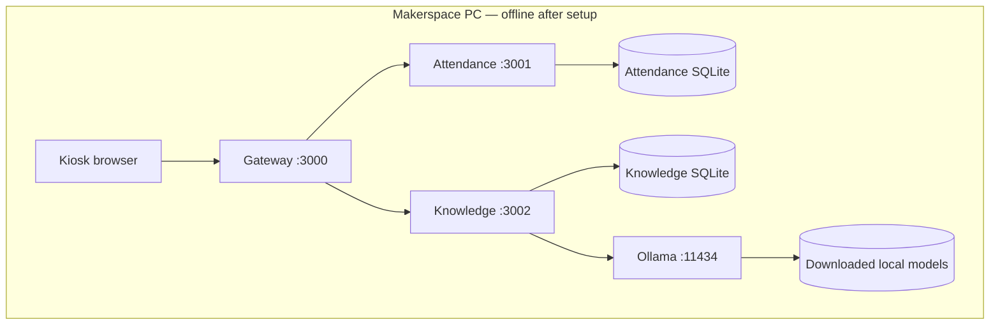
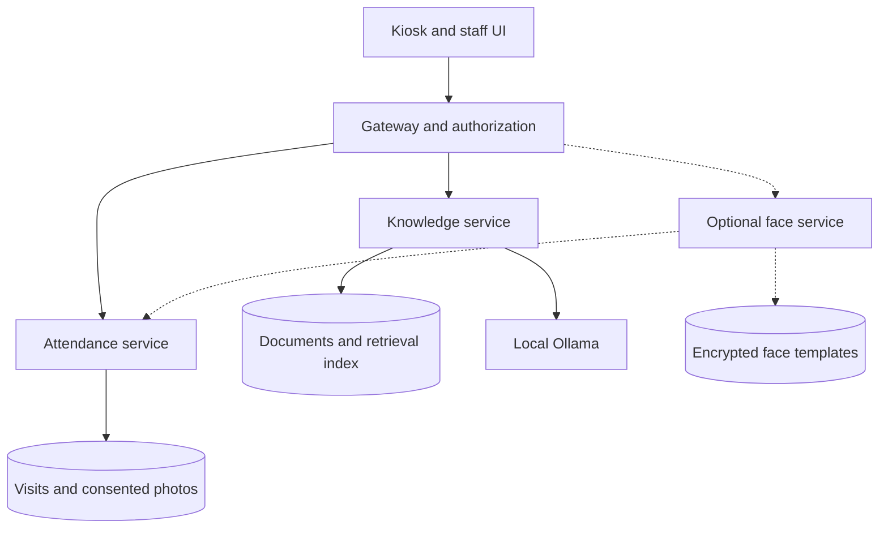
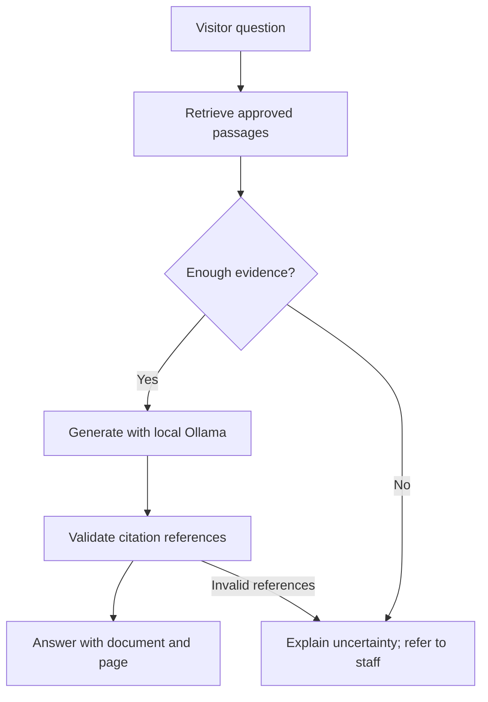

# Local-first microservice architecture

Status: MS-000 foundation is implemented and locally verified on Windows, including real CPU inference under application-scoped outbound firewall isolation and native console Ctrl+C/restart. The first diagram matches the running service boundaries; later-feature diagrams remain proposals. Linux/remote CI has not run. On this PC the developer probe needs --cpu because the existing Ollama CUDA runner crashes; no automatic fallback or driver change is introduced.

MS-001 adds locally verified gateway browser access controls: kiosk/staff sessions, private credential provisioning, CSRF/Origin/role checks and bounded login/API work. See [MS-001](../tasks/MS-001-access-controls.md) for contracts and evidence. No attendance or document feature is enabled by access controls alone.

MS-002 adds verified manual check-in/retries/retention; MS-003/MS-004 add approved local document evidence; MS-005 adds protected staff history/export. Attendance and staff history work without knowledge/Ollama and never claim a visit was saved before storage confirms it. See [MS-002](../tasks/MS-002-manual-checkin.md) and the later task records. Photos and LAN rollout remain separate tasks.

## Decision and tradeoff

Use a monorepo with independently runnable local services. A monorepo is one Git repository containing multiple applications; it does not mean one backend process. Each service owns its APIs, database, migrations, and tests. All services initially run on one PC.

This matches the requested microservice workflow and isolates AI work from attendance. It also adds process management, contracts, and failure handling compared with a single application. Keep the initial split to gateway, attendance, and knowledge. Do not make every class or feature its own service.

“Independent” means ordinary operation after setup needs no internet or cloud vendor. It does not eliminate the host computer, local processes, installed dependencies, models, power, or backups. One PC is a single point of failure. More services on that PC do not create high availability.

## Drawing 1 — the initial runnable foundation

Solid arrows are local HTTP calls. Database arrows show exclusive ownership. Kiosk production assets are served by the gateway; the browser remains a separate UI process.

MS-000 created metadata-only service databases and explicit Ollama diagnostics. MS-001 added gateway-owned access controls; MS-002 extends attendance with self-reported visits. MS-003 adds knowledge-owned approved PDF ingestion and a versioned local embedding index through explicit operator commands. There is still no visitor question endpoint. A developer CLI can explicitly run a harmless generation probe.

## Service ownership

MS-006 adds optional consented visit photos owned only by attendance: private normalized JPEGs, migration 3 consent/revocation metadata and a durable cleanup queue. Gateway derives original kiosk attempt scope and protects upload/withdrawal plus staff-only read/delete through fixed token-authenticated HTTP contracts. History keeps its original strict shape unless `photos=1` explicitly requests availability; cursors bind that flag, and CSV stays unchanged. The post-confirmation camera UI has separate consent and explicit capture/save, stops tracks and clears transient buffers; camera denial never changes the recorded visit. Staff loads private pixels only on request. No photo reaches knowledge/Ollama or enrolls a face. Camera permission is now restricted to self, with microphone/geolocation disabled. See [MS-006](../tasks/MS-006-optional-photo.md) for resource/retention/proof boundaries and [photo operations](../LOCAL_SETUP.md#optional-visit-photo-ms-006) for migration/cleanup/backup limits.

| Component | Initial responsibility | Later responsibility | Owns data |
| --- | --- | --- | --- |
| Kiosk | Accessible shell and system status | Check-in and Ask screens; consent and captions | Transient UI state only; no persistent identity on kiosk |
| Gateway | Same-origin UI/API, status, kiosk/staff sessions, CSRF, authorization and limits | Authorized feature routing | Private staff hash file and bounded process-memory sessions |
| Attendance | Health/readiness, self-reported visits, idempotency/retention, protected staff history/export | Consented visit photos | Attendance DB; private photo directory added later |
| Knowledge | Health/readiness, Ollama adapter and diagnostics | Approved document ingestion, retrieval, answer orchestration and citations | Knowledge DB, document files and derived index |
| Ollama | Local inference runtime | Chat generation and local text embeddings | Downloaded model files; no authoritative attendance data |
| Optional face service (MS-007) | Separate loopback CPU matching process, disabled by default | Explicit enrollment, withdrawal and scoped match consumption through HTTP | Separate AES-GCM-encrypted enrollment store, key and pinned local model files |

Do not share a database or import another service's repository classes. A service may share API schemas, request IDs, and logging helpers. Shared types do not transfer data ownership. Use opaque IDs for references across services; no cross-service foreign keys or SQL joins.

## Drawing 2 — later feature boundaries

All components stay local. Dotted edges represent future capabilities. Photos are attendance data; face templates are a different, separately consented data type.

MS-007 implements two narrow authenticated HTTP contracts: face obtains original manual-visit identity from attendance, and attendance consumes a short-lived scoped face ticket before writing its own visit transaction. Neither service imports the other's database or repository. Exact retained attendance receipts remain retryable after ticket expiry or face outage; different tickets and manual/face attempts conflict. The optional face service owns encrypted templates, consent expiry/revocation and pinned local models. It runs inference only in bounded short-lived CPU workers with native telemetry explicitly disabled before launch. Shared packages contain strict wire schemas and signing/HTTP helpers only. Optional voice remains a later task.

## Interfaces and network boundaries

| Listener | Initial binding | Callers |
| --- | --- | --- |
| Gateway 3000 | `127.0.0.1` | Local browser and local diagnostics |
| Attendance 3001 | `127.0.0.1` | Gateway; service token required except liveness |
| Knowledge 3002 | `127.0.0.1` | Gateway/diagnostic CLI; service token required except liveness |
| Ollama 11434 | `127.0.0.1` | Knowledge service only by application convention |
| Vite 5173 | `127.0.0.1`, development only | Local browser; proxies `/api` to gateway |

Ollama's local API is not our user authorization boundary. Do not expose its port on the LAN. The application validates configured destinations and never accepts an arbitrary URL or model from a visitor. Binding to loopback does not defend against a compromised local OS account; host security remains necessary.

Use `/api/v1` for browser contracts and `/internal/v1` for service contracts. Runtime-validate incoming data and response shapes. The gateway does not contain attendance business rules or SQL. Add a contract version/new field compatibly before removing old fields, and test consumers when a contract changes.

Initial internal authentication is a generated shared local service token stored outside Git. Before any future LAN/multi-host deployment, replace it with scoped credentials per caller/service and authenticated encrypted transport. The gateway must strip caller-supplied internal identity headers and construct its own trusted context only after authorization.

### Browser access controls (MS-001)

The gateway owns browser authorization. Its staff credential is a strict, fixed-cost salted scrypt record under `<RUNTIME_DIR>/gateway/staff-credential.json`; the operator creates it with a masked terminal command. Missing credentials disable staff login while kiosk/status remain usable. Corrupt or symlinked credential storage fails gateway startup. Passwords, cookie tokens and browser identity are never forwarded to the domain services or Ollama.

Sessions are deliberately bounded process memory rather than the originally proposed durable session store. Restart revokes all sessions; no auth database or migration is introduced. Separate 128-kiosk/16-staff capacities prevent kiosk churn from evicting staff. Lookup keys are session-token SHA-256 digests. Independent CSRF tokens, inclusive idle/absolute deadlines and token rotation are gateway-local business logic, not shared-package services. This single-gateway decision must be revisited before replicas or LAN rollout.

Browser v1 routes are `POST/GET /api/v1/session` and `POST /api/v1/staff/login` / `logout`. The cookie is host-only, HttpOnly, SameSite=Strict and Path=/; Secure requires MS-009 HTTPS. Mutations need an exact allowed Origin and session CSRF header; initial bootstrap additionally needs a custom non-simple header. Fetch Metadata rejects cross-site/same-site API requests. Every future protected route must call the gateway's role/CSRF guard. No arbitrary upstream proxy or fake staff feature is exposed. Schemas contain request IDs and bounded role/CSRF/expiry metadata only; the bearer token is cookie-only. See the [operator runbook](../LOCAL_SETUP.md#local-staff-access-ms-001) for policies, shared rate limits and local-account/Windows ACL limits.

### Manual attendance contract (MS-002)

Kiosk-role `POST /api/v1/checkin` requires Origin/CSRF and a strict name/NetID/UUID body. The gateway supplies the opaque session namespace and its own internal token/request ID to `POST /internal/v1/visits`. It never imports SQLite or attendance repositories. Attendance validates, applies retention and inserts/replays in an immediate transaction. A unique attempt digest prevents duplicates; changed normalized details under that key conflict. Confirmation contains only an opaque visit ID, server UTC time and fixed self-reported/replayed flags. Model or knowledge failure cannot gate this path.

Migration 2 appends a strict visits table and timestamp index after the known foundation migration. Startup never migrates or replaces a missing DB. Attendance deletes rows at/before the 30-day project cutoff at startup, hourly, before writes and through the explicit cleanup CLI. Failed maintenance reports a fixed redacted event and unavailable readiness. Later history/photo reads must enforce expiry independently of cleanup. Secure-delete is enabled on owned connections; logical deletion does not guarantee erasure from WAL/SSDs/backups. No institution-approved retention policy is implied.

Gateway bounds check-in to ten attempts/minute, fixed loopback paths, two seconds and 4096 response bytes, validating status/body/request ID with no automatic retries. The browser keeps an uncertain attempt only in component memory and explicitly retries its same UUID; a new session/reset clears identity/attempt state. The same request may commit despite a lost reply, so failure feedback says confirmation is uncertain. API/network failure never creates a persistent browser queue or fake success.

### Staff history contract (MS-005)

Staff-role gateway `GET /api/v1/staff/visits` and CSRF/Origin-protected `POST /api/v1/staff/visits/export` call only token-authenticated attendance contracts. Attendance owns SQL, read-time 30-day expiry, Chicago/DST date bounds, HMAC ten-minute cursors and CSV formatting. Descending time/UUID keyset pages carry a snapshot plus rowid high-water mark, so equal-millisecond new inserts cannot enter an existing sequence. No cursor identity data or SQL crosses service boundaries. Gateway bounds work/bytes/rates, strips browser headers and rechecks staff access after the upstream response before releasing identities.

Exports are explicit, capped at 500 matches, quoted UTF-8 CSV with formula-leading text neutralization; over-limit exports fail rather than truncate. No export file is stored server-side. Downloaded copies require separate private access/retention and are not a universal spreadsheet-safe/lossless import format. Staff rows/cursors live only in mounted UI memory; logout/reset/expiry clears/aborts work and revokes blob URLs. The service remains independent of AI. See [MS-005](../tasks/MS-005-staff-history.md) and [runbook](../LOCAL_SETUP.md#staff-visit-history-and-export-ms-005) for exact contracts/checks/limitations. No schema/dependency change.

### Bootstrap configuration contract (MS-000 group 2b)

`local/packages/config/` is a Node-only technical helper with no domain services or database models. Its pure parser validates common environment settings; its explicit loader reads workspace `.env` and applies known process environment overrides without mutating `process.env`. Each service entrypoint explicitly validates this bootstrap schema before binding; service-specific domain configuration will belong to the owning service when introduced.

Only literal IPv4 loopback HTTP origins are accepted, with matching service URL/listener ports and no collisions with other listeners, Vite, or Ollama. Runtime paths remain inside ignored workspace `.runtime/`, with separate attendance and knowledge directories; symlinks/junctions are rejected. `.env` contains a generated 256-bit service token, never returned by configuration CLI output. `setup:local` uses exclusive file creation and never replaces existing configuration. `config:check` verifies settings without querying dependencies. A blank model produces `model_not_configured`. See [the setup runbook](../LOCAL_SETUP.md#application-configuration) for precedence, format, and platform limits.

The implemented request path is browser to gateway, gateway to authenticated attendance/knowledge HTTP routes, and knowledge to fixed Ollama discovery paths. Generation exists only as an explicitly invoked knowledge CLI. Shared packages provide strict v1 schemas, request IDs, allowlisted logging and bounded HTTP helpers; gateway imports no service implementation or database. Aggregate requests use concurrent two-second calls and a five-second shared snapshot cache. Built assets are served from a fixed validated route map with same-origin CSP and disabled camera/microphone permissions. Native Node 24 runs separate TypeScript processes; Vite bundles local production assets and runs only in development.

## Local data strategy

- One SQLite database file per owning service, accessed through a repository interface. Each service has versioned, append-only migrations and parameterized queries.
- Attendance stores UTC timestamps; display them in `America/Chicago`. Identity supplied by a visitor is labeled self-reported, not university verified.
- Photos/documents live in separate private service directories, never a public web folder. Owners enforce authorization and retention on reads as well as cleanup.
- Knowledge stores document hash/version, page/chunk metadata, embedding model ID/digest, dimensions, and index version. Changing embedding model requires a new index; never mix incompatible vectors.
- For a small approved document collection, begin with a simple local index behind an interface. Select its implementation in the retrieval task based on measured corpus size. Do not add a hosted vector database or a second search service now.
- Backups must include relevant databases, files, configuration references, and encryption-key recovery. Use a SQLite-safe backup procedure or stop writers; do not copy only the main DB file while WAL writes continue. A restore drill is part of the operations task.

SQLite is a deliberate single-host starting point. It is not a horizontally distributed database. If measured concurrent writes, lock contention, dataset size, or multiple hosts exceed the design, migrate the owning service to a self-hosted PostgreSQL instance with verified export/import and rollback. Do not place a SQLite file on a network share or run independent replicas writing copies of it.

## Local AI and document answers

MS-004 now implements kiosk `POST /api/v1/question` through token-authenticated knowledge `POST /internal/v1/answers`. Gateway requires kiosk role/Origin/CSRF, strips supplied identity and forwards only a strict bounded question. Knowledge requires a complete compatible current index, embeds the query and ranks at most four passages. The separate local chat model selects at most two verbatim excerpts with short source aliases. Only repository-owned document/version/hash/page metadata creates citations. Fixed schema, substring/sentence-boundary and conservative English quantity guards reject unsupported output; missing evidence refers to staff. Responses render as plain text. This constrained extraction avoids unverified free-form policy claims, but does not prove semantic relevance or cover every qualification in a full document.

Question work has one active slot/no queue, a 90-second deadline, fixed loopback endpoints, explicit CPU settings and digest rechecks. Only the bounded question routes extend the ordinary five-second socket timeout. Gateway limits six attempts/minute, validates upstream request IDs/status/schema, rechecks session expiry and propagates disconnect cancellation. The UI stores no conversation, clears/aborts on cancel/back/reset/expiry and does not forward attendance/auth identity to models. Attendance remains independent. See [MS-004](../tasks/MS-004-grounded-answers.md) for contracts, real synthetic evaluation, the discovered missing-duration failure/fix and platform/quality limits; [setup](../LOCAL_SETUP.md#grounded-document-questions-ms-004) covers deliberate operator enablement.

MS-003 implements the evidence store: a bounded local PDF.js worker extracts page text, deterministic chunks are embedded by fixed-loopback Ollama calls, and knowledge migration 2 atomically publishes immutable document versions and compatible index memberships. Private source names are content hashes. Model name/digest/dimensions/prefixes/chunker identity prevent vector mixing. Complete-corpus checks also compare stored chunk counts; reindex rejects a changed corpus snapshot. No database transaction spans a model call. Failed/cancelled preparation preserves prior evidence. Operator approval, quotas, model licensing, startup configuration validation and rollback details are recorded in [MS-003](../tasks/MS-003-document-ingestion.md) and the [runbook](../LOCAL_SETUP.md#approved-document-ingestion-ms-003). Shared packages contain no knowledge repository. Public question/answer contracts are still MS-004.

Ollama handles inference; it does not automatically know Makerspace policies. The knowledge feature must retrieve relevant approved document passages and supply them with the question. “RAG” means retrieving evidence before generating the answer.

Treat retrieved text as data, never privileged instructions. Give the model no shell, database, check-in, or access-control tools. Validate citations against retrieved chunk IDs; that checks reference validity, not factual correctness by itself. Evaluate groundedness with known questions before enabling answers. Never claim a generated answer authorizes equipment use or replaces required staff training.

Do not send names, NetIDs, photos, or face templates into prompts. Do not persist conversation text by default. Request bounded context/output and support cancellation. Keep chat and embedding model settings distinct. Document model licenses and exact selected digests; hardware is not yet known, so no specific model performance is promised.

## Failure behavior and scaling

| Condition | Required behavior |
| --- | --- |
| Ollama stopped or model missing | Knowledge reports degraded AI; manual attendance remains usable; no cloud fallback |
| Knowledge service down | Gateway keeps serving UI; Ask is unavailable; attendance remains isolated |
| Attendance DB unavailable | Do not show successful check-in or silently queue personal data in browser storage |
| Duplicate/retried check-in | Transaction plus session-scoped idempotency key prevents duplicate visit creation |
| AI overload, later | Bound concurrent generations and queue length; return explicit busy/retry status |
| Client disconnect | Cancel upstream inference where supported; enforce timeout regardless |
| Host power loss | All services stop; restart and data recovery are operations responsibilities |

Initial health requests have short timeouts and no retries. Later retry only safe reads or writes with established idempotency. Begin with one model generation at a time, then measure before increasing concurrency. Record CPU/RAM/GPU use, cold/warm answer latency, queue depth, database contention, and error rates without logging student content.

Scale in stages: optimize the measured bottleneck on one PC; move an overloaded service to a dedicated local machine; then add replicas and a suitable shared database if justified. Add a durable job queue only when ingestion or other long jobs require retries and crash recovery. Do not claim Kubernetes or a broker alone makes the project scalable.

## Device/deployment modes

**Initial:** a browser on the same Windows PC as Node and Ollama. Run natively; no container engine required. The PC can work without internet after assets/dependencies/models are installed.

**Later:** an iPad on the same local network reaches only the gateway through trusted HTTPS. Local Wi-Fi can exist without internet, but the PC must remain powered and reachable. `localhost` on the iPad means the iPad, not the PC. Camera/microphone use on a LAN origin requires a secure browser context; plain `http://192.168.x.x` is not a dependable solution. Implement trusted certificates, firewall rules, auth, and actual Safari testing in the LAN task.

## Migration from the existing application

The baseline checkout is the separate `Abhinash2018/Makerspace-V1` repository and contains documentation only. Keep `AGENTS.md`, `README.md`, and `docs/` at root. MS-000 adds the runtime workspace under `local/`, root CI as needed, and updates these documents. There is no legacy app or root package-manager workspace here to migrate or exclude. The older MakerspaceAssistant repository remains a separate historical reference; this task makes no changes to it.

MS-000 does not cut over hosting, import live databases, or port every feature. Later feature tasks may selectively reuse reviewed UI/schema/test ideas while replacing Cloudflare bindings with service-owned local repositories and OpenAI calls with Ollama. Validate any reused code when that task begins.

Preserve the existing app's documented behavior when migrating: optional photo, separate face enrollment consent, self-reported identity labeling, protected history/photos, no automatic enrollment of old photos, no door unlocking, and no implied occupancy measurement. The old documented 30-day visit/photo and 90-day enrollment retention values are project defaults, not a new institutional policy approval.

## Reference sources

These sources explain external API/browser behavior; the service split and deployment choices above are this project's proposal.

- [Existing application README at inspected commit](https://github.com/Abhinash2018/MakerspaceAssistant/blob/ad50c184b3e4914e01e00e6eb862bc26fec3e0a9/README.md)
- [Ollama FAQ and local-only configuration](https://docs.ollama.com/faq)
- [Ollama chat endpoint](https://docs.ollama.com/api/chat)
- [Ollama model listing](https://docs.ollama.com/api/tags)
- [Ollama embedding endpoint](https://docs.ollama.com/api/embed)
- [MDN camera/microphone secure-context requirements](https://developer.mozilla.org/en-US/docs/Web/API/MediaDevices/getUserMedia)

## Conversational PDF RAG (MS-011)

The student Ask screen is now a conversation. Browser `POST /api/v1/chat` carries a normalized question and up to three alternating user/assistant pairs (10,000 UTF-8 history bytes). Gateway checks kiosk role, Origin, CSRF and a six-attempt/minute limit, forwards only this strict payload to token-authenticated `POST /internal/v1/chat`, cancels on disconnect and rechecks session access before returning. Each route accepts at most 16 KiB; replies are bounded to 32 KiB. Existing `/api/v1/question` and `/internal/v1/answers` remain compatible excerpt contracts.

Knowledge combines the question with recent user questions for semantic/lexical retrieval from the current complete index. Broad access questions expand to prerequisite/account/reservation terms. Up to four distinct pages, at most three per document, go to the configured local CPU model; only prior user questions are model context; assistant claims never become model evidence. One active request per chat engine, no queue, 110-second deadline, model-digest and current-source checks bound work. A generated answer (at most 1,200 characters and 400 predicted tokens, CPU context 6,144) selects up to four source aliases; the server attaches original passages and immutable title/page/version/hash metadata. This validates provenance, not the semantic truth of paraphrases. No attendance/face data, tools, external search, cloud fallback or general Ollama proxy is involved.

The browser retains at most twelve turns and sends only three completed pairs. New chat, leaving, unmounting, reset and access loss clear memory. No chat database, browser storage or prompt logging is added. Enter sends; Shift+Enter inserts a line break; stop and retry preserve the intended question without duplicate turns.

Explicit operator ingestion supports `--ocr` for image-only PDFs on Windows with installed English OCR, using Windows.Data.Pdf and Windows.Media.Ocr in a bounded child process. Native PDF.js extraction stays unchanged. Knowledge migration 3 transactionally expands parser provenance without deleting version/chunk history; reindex respects the original parser. `knowledge retire --approved --key ...` removes active membership only and preserves originals/history. OCR is never invoked by a student request. See [MS-011](../tasks/MS-011-local-rag-chat.md) for actual-corpus and model verification.
