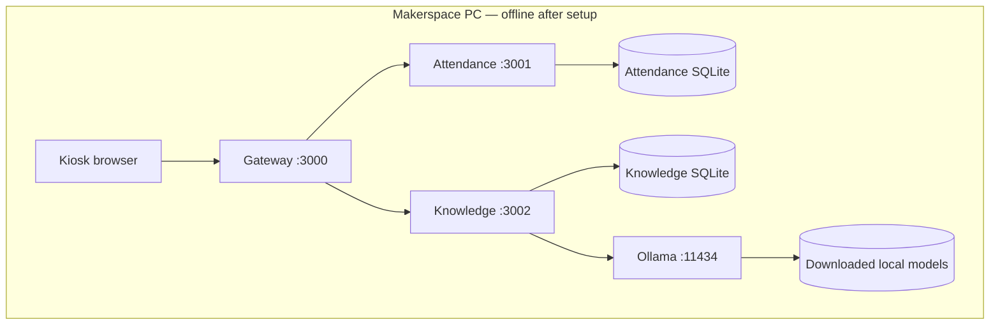
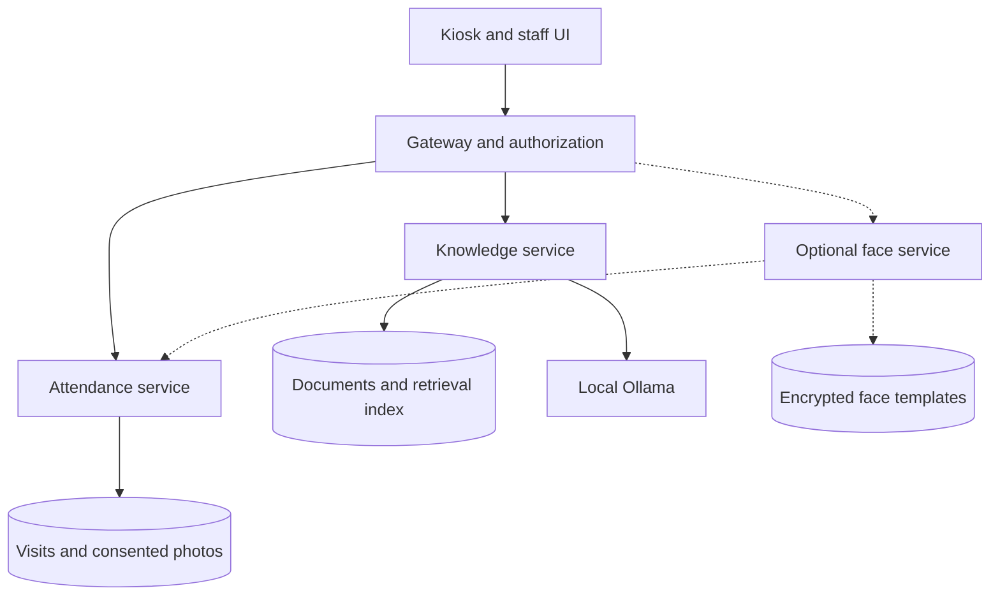
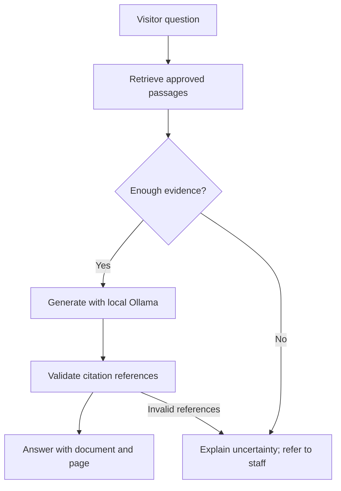

# Local-first microservice architecture

Status: MS-000 foundation is implemented and locally verified on Windows, including real CPU inference under application-scoped outbound firewall isolation and native console Ctrl+C/restart. The first diagram matches the running service boundaries; later-feature diagrams remain proposals. Linux/remote CI has not run. On this PC the developer probe needs --cpu because the existing Ollama CUDA runner crashes; no automatic fallback or driver change is introduced.

## Decision and tradeoff

Use a monorepo with independently runnable local services. A monorepo is one Git repository containing multiple applications; it does not mean one backend process. Each service owns its APIs, database, migrations, and tests. All services initially run on one PC.

This matches the requested microservice workflow and isolates AI work from attendance. It also adds process management, contracts, and failure handling compared with a single application. Keep the initial split to gateway, attendance, and knowledge. Do not make every class or feature its own service.

“Independent” means ordinary operation after setup needs no internet or cloud vendor. It does not eliminate the host computer, local processes, installed dependencies, models, power, or backups. One PC is a single point of failure. More services on that PC do not create high availability.

## Drawing 1 — the initial runnable foundation

Solid arrows are local HTTP calls. Database arrows show exclusive ownership. Kiosk production assets are served by the gateway; the browser remains a separate UI process.

In MS-000 the service databases contain migration metadata only. Knowledge checks local model availability; a CLI can explicitly run a harmless generation probe. No visitor question endpoint, identity, or student storage is enabled yet.

## Service ownership

| Component | Initial responsibility | Later responsibility | Owns data |
| --- | --- | --- | --- |
| Kiosk | Accessible shell and system status | Check-in and Ask screens; consent and captions | Transient UI state only; no persistent identity on kiosk |
| Gateway | Same-origin UI/API entry; status aggregation; request limits | Browser sessions, CSRF, authorization and staff routing | Session/auth store added in MS-001 |
| Attendance | Health/readiness and migration skeleton | Visits, idempotency, retention, staff history, consented visit photos | Attendance DB and private photo directory |
| Knowledge | Health/readiness, Ollama adapter and diagnostics | Approved document ingestion, retrieval, answer orchestration and citations | Knowledge DB, document files and derived index |
| Ollama | Local inference runtime | Chat generation and local text embeddings | Downloaded model files; no authoritative attendance data |
| Face service, later | Not scaffolded or running now | Opt-in enrollment, template matching, expiry/revocation | Separate encrypted template store |

Do not share a database or import another service's repository classes. A service may share API schemas, request IDs, and logging helpers. Shared types do not transfer data ownership. Use opaque IDs for references across services; no cross-service foreign keys or SQL joins.

## Drawing 2 — later feature boundaries

All components stay local. Dotted edges represent future capabilities. Photos are attendance data; face templates are a different, separately consented data type.

The future Face → Attendance edge is a narrow authenticated API call to create an idempotent visit after an allowed match. It is not direct database access. Design its signed/short-lived identity proof and failure handling in the face task before implementation. Optional voice is an adapter inside knowledge initially; split a voice worker only if CPU/GPU load or process isolation justifies it.

## Interfaces and network boundaries

| Listener | Initial binding | Callers |
| --- | --- | --- |
| Gateway 3000 | `127.0.0.1` | Local browser and local diagnostics |
| Attendance 3001 | `127.0.0.1` | Gateway; service token required except liveness |
| Knowledge 3002 | `127.0.0.1` | Gateway/diagnostic CLI; service token required except liveness |
| Ollama 11434 | `127.0.0.1` | Knowledge service only by application convention |
| Vite 5173 | `127.0.0.1`, development only | Local browser; proxies `/api` to gateway |

Ollama's local API is not our user authorization boundary. Do not expose its port on the LAN. The application validates configured destinations and never accepts an arbitrary URL or model from a visitor. Binding to loopback does not defend against a compromised local OS account; host security remains necessary.

Use `/api/v1` for browser contracts and `/internal/v1` for service contracts. Runtime-validate incoming data and response shapes. The gateway does not contain attendance business rules or SQL. Add a contract version/new field compatibly before removing old fields, and test consumers when a contract changes.

Initial internal authentication is a generated shared local service token stored outside Git. Before any future LAN/multi-host deployment, replace it with scoped credentials per caller/service and authenticated encrypted transport. The gateway must strip caller-supplied internal identity headers and construct its own trusted context only after authorization.

### Bootstrap configuration contract (MS-000 group 2b)

`local/packages/config/` is a Node-only technical helper with no domain services or database models. Its pure parser validates common environment settings; its explicit loader reads workspace `.env` and applies known process environment overrides without mutating `process.env`. Each service entrypoint explicitly validates this bootstrap schema before binding; service-specific domain configuration will belong to the owning service when introduced.

Only literal IPv4 loopback HTTP origins are accepted, with matching service URL/listener ports and no collisions with other listeners, Vite, or Ollama. Runtime paths remain inside ignored workspace `.runtime/`, with separate attendance and knowledge directories; symlinks/junctions are rejected. `.env` contains a generated 256-bit service token, never returned by configuration CLI output. `setup:local` uses exclusive file creation and never replaces existing configuration. `config:check` verifies settings without querying dependencies. A blank model produces `model_not_configured`. See [the setup runbook](../LOCAL_SETUP.md#application-configuration) for precedence, format, and platform limits.

The implemented request path is browser to gateway, gateway to authenticated attendance/knowledge HTTP routes, and knowledge to fixed Ollama discovery paths. Generation exists only as an explicitly invoked knowledge CLI. Shared packages provide strict v1 schemas, request IDs, allowlisted logging and bounded HTTP helpers; gateway imports no service implementation or database. Aggregate requests use concurrent two-second calls and a five-second shared snapshot cache. Built assets are served from a fixed validated route map with same-origin CSP and disabled camera/microphone permissions. Native Node 24 runs separate TypeScript processes; Vite bundles local production assets and runs only in development.

## Local data strategy

- One SQLite database file per owning service, accessed through a repository interface. Each service has versioned, append-only migrations and parameterized queries.
- Attendance later stores UTC timestamps; display them in `America/Chicago`. Identity supplied by a visitor is labeled self-reported, not university verified.
- Photos/documents live in separate private service directories, never a public web folder. Owners enforce authorization and retention on reads as well as cleanup.
- Knowledge stores document hash/version, page/chunk metadata, embedding model ID/digest, dimensions, and index version. Changing embedding model requires a new index; never mix incompatible vectors.
- For a small approved document collection, begin with a simple local index behind an interface. Select its implementation in the retrieval task based on measured corpus size. Do not add a hosted vector database or a second search service now.
- Backups must include relevant databases, files, configuration references, and encryption-key recovery. Use a SQLite-safe backup procedure or stop writers; do not copy only the main DB file while WAL writes continue. A restore drill is part of the operations task.

SQLite is a deliberate single-host starting point. It is not a horizontally distributed database. If measured concurrent writes, lock contention, dataset size, or multiple hosts exceed the design, migrate the owning service to a self-hosted PostgreSQL instance with verified export/import and rollback. Do not place a SQLite file on a network share or run independent replicas writing copies of it.

## Local AI and document answers — future contract

Ollama handles inference; it does not automatically know Makerspace policies. The knowledge feature must retrieve relevant approved document passages and supply them with the question. “RAG” means retrieving evidence before generating the answer.

Treat retrieved text as data, never privileged instructions. Give the model no shell, database, check-in, or access-control tools. Validate citations against retrieved chunk IDs; that checks reference validity, not factual correctness by itself. Evaluate groundedness with known questions before enabling answers. Never claim a generated answer authorizes equipment use or replaces required staff training.

Do not send names, NetIDs, photos, or face templates into prompts. Do not persist conversation text by default. Request bounded context/output and support cancellation. Keep chat and embedding model settings distinct. Document model licenses and exact selected digests; hardware is not yet known, so no specific model performance is promised.

## Failure behavior and scaling

| Condition | Required behavior |
| --- | --- |
| Ollama stopped or model missing | Knowledge reports degraded AI; attendance remains usable once implemented; no cloud fallback |
| Knowledge service down | Gateway keeps serving UI; Ask is unavailable; attendance remains isolated |
| Attendance DB unavailable | Do not show successful check-in or silently queue personal data in browser storage |
| Duplicate/retried check-in, later | Transaction plus idempotency key prevents duplicate visit creation |
| AI overload, later | Bound concurrent generations and queue length; return explicit busy/retry status |
| Client disconnect | Cancel upstream inference where supported; enforce timeout regardless |
| Host power loss | All services stop; restart and data recovery are operations responsibilities |

Initial health requests have short timeouts and no retries. Later retry only safe reads or writes with established idempotency. Begin with one model generation at a time, then measure before increasing concurrency. Record CPU/RAM/GPU use, cold/warm answer latency, queue depth, database contention, and error rates without logging student content.

Scale in stages: optimize the measured bottleneck on one PC; move an overloaded service to a dedicated local machine; then add replicas and a suitable shared database if justified. Add a durable job queue only when ingestion or other long jobs require retries and crash recovery. Do not claim Kubernetes or a broker alone makes the project scalable.

## Device/deployment modes

**Initial:** a browser on the same Windows PC as Node and Ollama. Run natively; no container engine required. The PC can work without internet after assets/dependencies/models are installed.

**Later:** an iPad on the same local network reaches only the gateway through trusted HTTPS. Local Wi-Fi can exist without internet, but the PC must remain powered and reachable. `localhost` on the iPad means the iPad, not the PC. Camera/microphone use on a LAN origin requires a secure browser context; plain `http://192.168.x.x` is not a dependable solution. Implement trusted certificates, firewall rules, auth, and actual Safari testing in the LAN task.

## Migration from the existing application

The baseline checkout is the separate `Abhinash2018/Makerspace-V1` repository and contains documentation only. Keep `AGENTS.md`, `README.md`, and `docs/` at root. MS-000 adds the runtime workspace under `local/`, root CI as needed, and updates these documents. There is no legacy app or root package-manager workspace here to migrate or exclude. The older MakerspaceAssistant repository remains a separate historical reference; this task makes no changes to it.

MS-000 does not cut over hosting, import live databases, or port every feature. Later feature tasks may selectively reuse reviewed UI/schema/test ideas while replacing Cloudflare bindings with service-owned local repositories and OpenAI calls with Ollama. Validate any reused code when that task begins.

Preserve the existing app's documented behavior when migrating: optional photo, separate face enrollment consent, self-reported identity labeling, protected history/photos, no automatic enrollment of old photos, no door unlocking, and no implied occupancy measurement. The old documented 30-day visit/photo and 90-day enrollment retention values are project defaults, not a new institutional policy approval.

## Reference sources

These sources explain external API/browser behavior; the service split and deployment choices above are this project's proposal.

- [Existing application README at inspected commit](https://github.com/Abhinash2018/MakerspaceAssistant/blob/ad50c184b3e4914e01e00e6eb862bc26fec3e0a9/README.md)
- [Ollama FAQ and local-only configuration](https://docs.ollama.com/faq)
- [Ollama chat endpoint](https://docs.ollama.com/api/chat)
- [Ollama model listing](https://docs.ollama.com/api/tags)
- [Ollama embedding endpoint](https://docs.ollama.com/api/embed)
- [MDN camera/microphone secure-context requirements](https://developer.mozilla.org/en-US/docs/Web/API/MediaDevices/getUserMedia)
